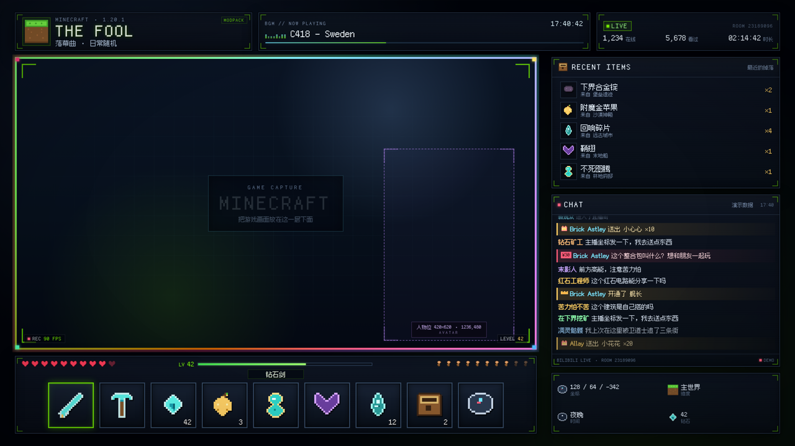
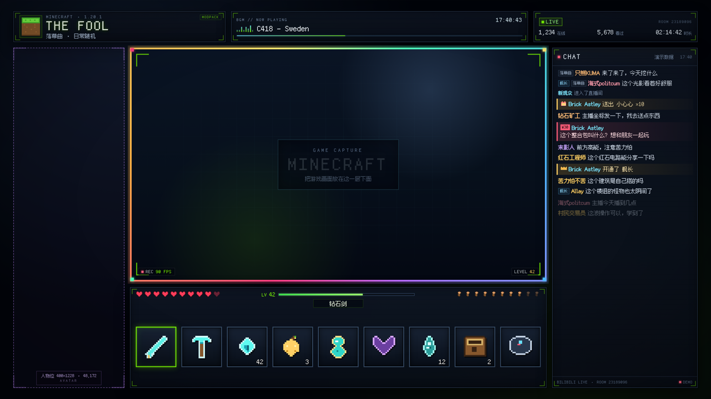
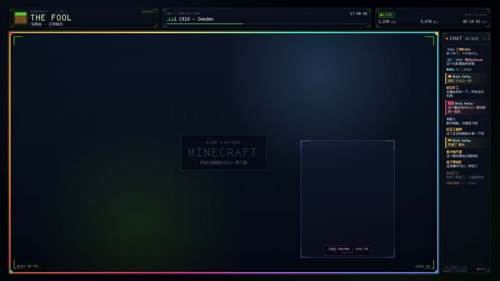
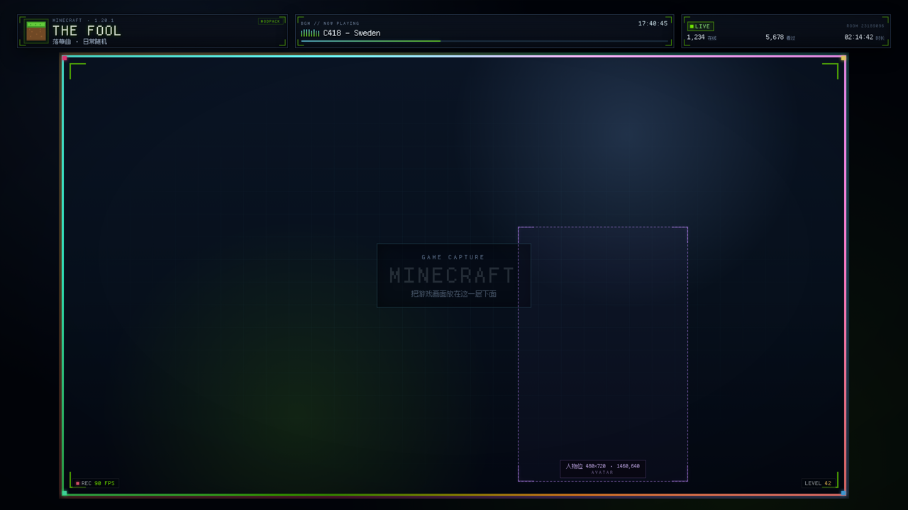

# OBS 直播覆盖层（Minecraft 混合风格）

给 OBS 浏览器源用的 **2560×1440** 覆盖层：像素中文、暗黑霓虹游戏框、固定内容面板，外加一个**留空的 VTuber 人物位**。内置 4 套版式，随时切换。


## 设计原则

- **静态为主**：物品栏、最近获得、坐标/维度都是 `config.js` 里的固定数据，不依赖游戏 mod，开箱即用。
- **只有聊天是实时的**：B 站弹幕由本地 Rust 桥接直连，不经过第三方云服务。
- **给人物留位**：每套版式都有一块透明的「人物位」，自己在 OBS 里把 VTuber / PNGTuber 捕获放进去即可；覆盖层只画四个像素角标做装饰。
- **对位可视化**：URL 加 `?guide=1` 会在画面上标出游戏画面和人物位的精确坐标与尺寸。

## 4 套版式

| 版式 | 说明 | 游戏画面 | 人物位 | 其他 |
| --- | --- | --- | --- | --- |
| `classic` | 经典 · 游戏 + 右栏 | `48,184` `1680×945` | `1236,480` `420×620`（叠在游戏右下） | 右侧 最近/聊天/状态，下方物品栏 |
| `duo` | 双人 · 左人 + 游戏 + 聊天 | `468,172` `1500×844` | `48,172` `400×1228`（左侧竖条） | 右侧聊天，下方大物品栏 |
| `focus` | 专注 · 游戏最大化 | `48,164` `2196×1236` | `1540,720` `480×600`（叠在右下） | 右侧窄聊天 |
| `bare` | 极简 · 只有游戏和小人 | `174,156` `2212×1244` | `1460,640` `480×720` | 只有顶栏 |

| classic | duo |
| --- | --- |
|  |  |

| focus | bare |
| --- | --- |
|  |  |

坐标都是 2560×1440 画布上的像素值（左上角为基准）。

## 切换版式

改 `web/config.js` 里的 `defaultLayout`，或者在 OBS 浏览器源 URL 后加参数：

```text
http://127.0.0.1:9100/?layout=duo
```

常用参数：

| 参数 | 作用 |
| --- | --- |
| `layout=classic\|duo\|focus\|bare` | 选版式 |
| `guide=1` | 显示游戏画面/人物位的虚线框和尺寸（对位时用，正式直播去掉） |
| `preview=1` | 给游戏洞加占位底图，方便在浏览器里看效果（OBS 里不要带） |
| `demo=1` | 循环假弹幕/礼物/SC，调视觉用 |

## 快速开始

```bash
cd ~/Sonder-dotfiles-arch/tools/obs-overlay
cp config.example.toml config.toml
$EDITOR config.toml          # 填 room_id
cargo build --release
./target/release/obs-overlay-bridge
```

打开 <http://127.0.0.1:9100/?demo=1&preview=1> 看效果。OBS 浏览器源只填：

```text
http://127.0.0.1:9100/
```

## OBS 接入

1. **游戏画面**：推荐「窗口采集 (PipeWire)」选 Minecraft 窗口。整屏采集会把桌面和别的窗口一起录进去。
2. 游戏画面放在覆盖层**下面**，按上表的「游戏画面」坐标和尺寸对齐。
   - 用「缩放 / 边界框」把画面填满该区域（保持 16:9）。
   - 不确定对不对？浏览器源 URL 加 `?guide=1`，画面会直接把数字写在框上。
3. **浏览器源**：URL `http://127.0.0.1:9100/`，尺寸 **2560×1440**，放在最上层。
   - 自定义帧率：**90**
   - 不要勾“通过 OBS 控制音频”
4. **VTuber / PNGTuber**：自己做捕获，尺寸和位置按人物位摆放。
   - 想让人物压在装饰角标**上面**：把人物源放在浏览器源之上。
   - 想让人物被角标框住：放在浏览器源之下。
5. 音频照旧：桌面音频 + 麦克风。

## 自定义

- `web/config.js`
  - 文案：`title` / `subtitle` / `kicker` / `bgm`
  - 版式表：`layouts` 里每个版式的 `x/y/w/h`，随便改，面板会跟着走
  - 内容：`hotbar`（9 格）、`recentItems`、`stats`（坐标/维度/昼夜/钻石）
- `web/style.css`：颜色和边框。主要变量在 `:root`，例如 `--accent`（草绿）、`--gold`、`--red`、`--chat-font`。
- 字体是 [Fusion Pixel](https://github.com/TakWolf/fusion-pixel-font) 12px，OFL 许可，许可证在 `web/fonts/OFL.txt`。
- BGM：桥接每 4 秒调用 `playerctl metadata --format '{{artist}} - {{title}}'`；装了 `playerctl` 且有播放器就自动更新，否则显示 `bgm`。

想加第五套版式，在 `layouts` 里复制一段改名字和坐标即可，`layout=` 参数直接用。

## B 站弹幕桥接

- `getDanmuInfo` 的 `w_rid` 签名 + `buvid3/buvid4` Cookie，匿名连接，不需要登录。
- 支持：普通弹幕、礼物、SC、上舰、进场（JSON 版 `INTERACT_WORD`）；`INTERACT_WORD_V2` 是 protobuf，忽略。
- 房间离线时仍保持连接，开播自动变 LIVE；`/api/status` 可直接看状态。
- 预留了 `POST /api/event`（`recent_item` / `hotbar` / `stats`）给以后接游戏数据；默认不用，覆盖层是静态的。
- 如果 B 站以后改协议，可以换用 [blivechat](https://github.com/xfgryujk/blivechat)（或 [DoodleBears 改版](https://github.com/DoodleBears/blivechat)）作备用后端。

`config.toml` 已在 `.gitignore` 里，房号不会进仓库；模板是 `config.example.toml`。

## systemd

```bash
mkdir -p ~/.config/systemd/user
cp systemd/obs-overlay-bridge.service ~/.config/systemd/user/
systemctl --user daemon-reload
systemctl --user enable --now obs-overlay-bridge.service
systemctl --user restart obs-overlay-bridge.service   # 改完 config.toml 后用
journalctl --user -u obs-overlay-bridge.service -f
```

## 录制 2K 90fps 的配套设置

- OBS 输出：`2560×1440`、`90 FPS`，基础/输出分辨率一致，不要缩到 1080p。
- 编码器：**NVIDIA NVENC HEVC**，Rate Control **CQP**，CQ **20**，Preset **P5**，Multipass **qres**，Look-ahead **关**，B-frames **2**，Adaptive Quantization **开**。
- 分段：按大小 **8 GB**。实际码率约 30–80 Mbps，8 GB 约 14–36 分钟一段。
- OBS 必须用 **4070** 启动：桌面入口已设置 NVIDIA EGL 环境变量；从 Noctalia 的 OBS Control 按钮启动也已加同样变量。否则 OBS 回到 610M 核显，NVENC 走非纹理回退，1440p90 会明显卡。
- Minecraft 侧：`maxFps:90`、`enableVsync:false`。160Hz 屏上 100fps + VSync 会产生 1.6 倍刷新节奏。
- 还卡的话：把整屏采集换成窗口采集，游戏改无边框窗口。

## 排障

```bash
ss -tlnp | grep 9100
curl http://127.0.0.1:9100/api/status
journalctl --user -u obs-overlay-bridge.service -f
```

- 画面空白：确认桥接在跑、URL 没带 `?preview`/`?demo`、浏览器源尺寸是 2560×1440。
- 面板位置不对：`?guide=1` 看数字，或检查 `config.js` 里该版式的 `x/y/w/h`。
- 弹幕不显示：先看 `/api/status` 的 `connected` / `live`；房间没开播时聊天区是空的，属正常。
